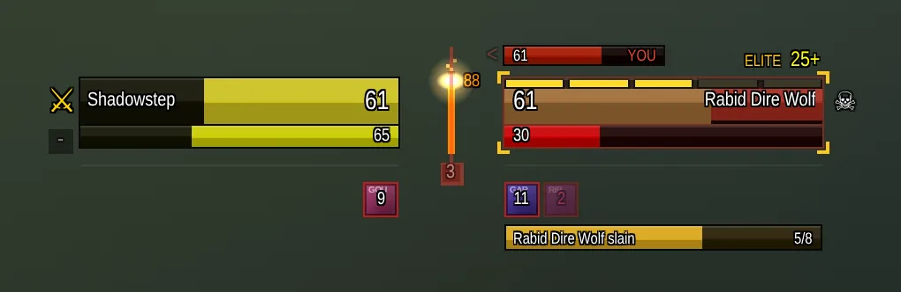

# Glance

Combat awareness at a glance, for World of Warcraft. **Works in both Classic and Forever.** Glance replaces the player
and target frames with two compact groups of bars that meet in the middle of the screen,
and puts what matters in a fight where your eyes already are.

## What it shows

- **Your bars and the target's**, mirrored around a spine in the middle: health, power,
  ammo or soul shards, combo points, cast bars in lanes that never make anything jump.
- **Known damage:** a green strip for what your DoTs will still deal, a pale tip for the
  spell on its way, and a callout: `DOTS KILL`, `KILL`, or `x3` more of your usual attack.
- **Threat** as a flame climbing the spine, and the **number of mobs on you** under it.
- **Hit flash:** each hit leaves a red chunk that shrinks away, on every health bar.
- **Warnings:** runners about to flee, interrupt windows, the execute zone, incoming
  adds, a potion when you're low, buffs you usually keep up that dropped, worn gear,
  full bags, your breath underwater, kills you haven't looted, and how you died.
- **Quest progress** for the mob you're targeting, with drop rates learned from your kills.
- **Raid marks** in one click, the target of target, kill pace, a swing timer, energy and
  mana ticks, your pet's health and mood.

Every part has a checkbox. Hover any part with help mode on (the `?` under your level) to
see what it means.

## Install

1. Download the latest `Glance-<version>.zip` from
   [Releases](https://github.com/LatentRune/glance/releases).
2. Unzip it into the `Interface/AddOns/` folder of the game you play (for Classic,
   `World of Warcraft/_classic_era_/Interface/AddOns/`), so you have
   `.../AddOns/Glance/Glance.toc`. The same zip works in Classic and Forever.
3. Restart the game, or `/reload`.

That's all. Glance starts in the middle of the screen with help mode on; nothing needs
setting up. The commands below are there when you want to change something.

## Commands

| Command | What it does |
|---|---|
| `/glance unlock` / `lock` | Show the blue boxes: drag to move, click for settings (Edit Mode does this too) |
| `/glance minimal` | Slim bars with almost no text |
| `/glance colors` | Deep or bright bar colors |
| `/glance blizzard` | Hide or show Blizzard's own player and target frames |
| `/glance reset` | Sizes and positions back to the defaults |
| `/glance help` | Help mode: hover anything to learn what it shows |
| `/glance cpu [seconds]` | Time what Glance costs while you play (30 seconds by default) |
| `/glance debug` | Live CPU and memory bars under yours |

Key bindings for skull and cross marks are under Glance in the game's key bindings.

## Feedback and contributing

Glance is built with its players. Tell us what reads well and what doesn't:

- [Report a bug](https://github.com/LatentRune/glance/issues/new?template=bug.yml)
- [Say how something looks](https://github.com/LatentRune/glance/issues/new?template=looks.yml)
- [Suggest an idea](https://github.com/LatentRune/glance/issues/new?template=idea.yml)

Questions, setups and quick feedback go to [Discord](https://discord.gg/wcCfAmMsFV). Longer conversations about
where Glance should go live in [Discussions](https://github.com/LatentRune/glance/discussions); everything filed so far is under
[Issues](https://github.com/LatentRune/glance/issues).

Want to change something yourself? You don't need the game running to see your change:
the screenshot tools draw Glance from its real code and put before-and-after pictures in
your pull request. Start with [CONTRIBUTING.md](CONTRIBUTING.md). If you use an AI coding
assistant, [prompts/](prompts/) has prompts ready to paste.

## Support Glance

Glance is free. If it helps you, you can
[leave a tip on Ko-fi](https://ko-fi.com/latentrune) or [support it monthly](https://buy.stripe.com/00wdR93RAdvsdxwaPwew801).

## TODO: community

Getting Glance in front of players and building a community around it.

- [x] Donations: Ko-fi and a Stripe monthly link, both on the repo's Sponsor button
      through `.github/FUNDING.yml`
- [ ] GitHub Sponsors, once the account is approved (add `github: [LatentRune]` to
      `.github/FUNDING.yml` and a button to `docs/index.html`)
- [ ] Listings on CurseForge and Wago, fed from GitHub releases
- [x] A Discord server for quick feedback, and GitHub Discussions for ideas worth keeping
- [ ] Turn on GitHub Pages (from `docs/`) for the landing page and `docs.html`
- [ ] A mailing list on Buttondown, one email per release, with a signup form back on the
      landing page
- [ ] Label 5 to 10 small look tweaks as `good first issue`
- [ ] A shared look across the landing page, donation pages and the Discord and
      CurseForge icons, taken from the addon's own colors

## License

[MIT](LICENSE).
